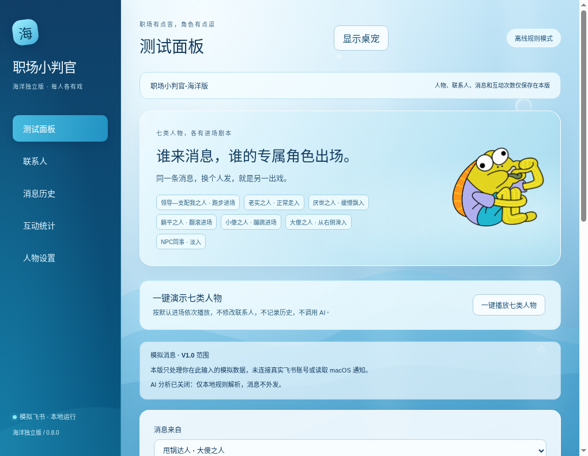
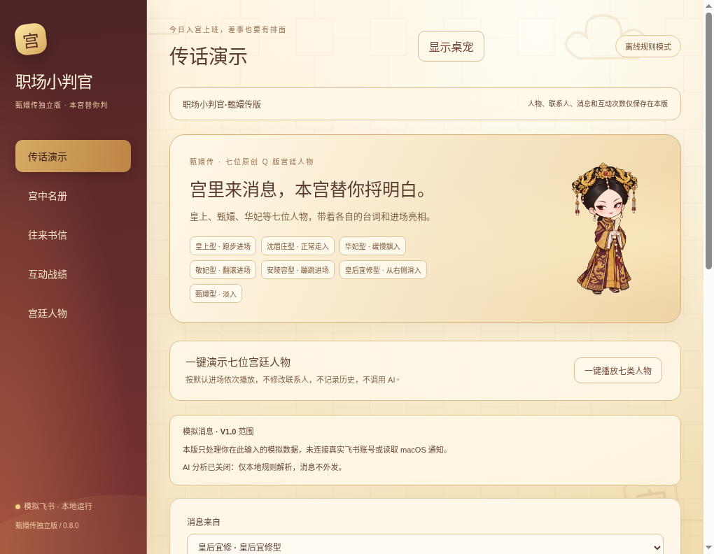

# 职场小判官 · 0.8.0

Electron + React + TypeScript 的 macOS 桌面消息助手。海洋版与甄嬛传版现为两个独立应用：固定控制台与人物、独立安装身份、独立联系人和数据。移除主题切换，两版可同时运行。

本仓库的 desktop-pet-mvp 分支维护共用代码，默认启动海洋版。用户应下载对应独立包：

| 独立版 | 下载源码 | 双击启动 |
| --- | --- | --- |
| 海洋版 | [海洋 0.8.0](https://github.com/jianingecho-ctrl/AI-Coding/archive/refs/tags/ocean-v0.8.0.zip) | 启动海洋版.command |
| 甄嬛传版 | [甄嬛传 0.8.0](https://github.com/jianingecho-ctrl/AI-Coding/archive/refs/tags/palace-v0.8.0.zip) | 启动甄嬛传版.command |

源码 ZIP 需要在 Mac 安装依赖并启动，不是已经打包的 .app。步骤见 [独立版指南](docs/独立版使用指南.md) 和 [Mac 教程](docs/Mac使用教程.md)。





## 两版设计

| 项目 | 海洋版 | 甄嬛传版 |
| --- | --- | --- |
| 控制台 | 海蓝渐变、海浪、气泡、浅色面板 | 朱红宫墙、窗棂、鎏金、素纸 |
| 人物 | 七类海洋人物，兼容旧版骆驼 | 皇上、沈眉庄、华妃、敬妃、安陵容、皇后宜修、甄嬛 |
| 导航 | 测试面板、联系人、消息历史、互动统计、人物设置 | 传话演示、宫中名册、往来书信、互动战绩、宫廷人物 |
| Bundle ID | cn.workplace.littlejudge.ocean | cn.workplace.littlejudge.palace |
| 数据目录名 | workplace-little-judge-ocean | workplace-little-judge-palace |

打开就进入本版。人物列表只显示本版人物，保存接口同样拒绝外版人物和主题。每版分别保存联系人、历史、回复、计数、素材、尺寸、声音、AI 设置与加密密钥。一版修改、清空或退出，不影响另一版。独立源码包只包含本版内置人物素材和对应启动脚本。

## 功能

- 透明、无边框、可拖动、可置顶桌宠，支持隐藏、恢复、退出。默认为旧尺寸的 60%，可调至 45%–100%，实际窗口随待机与卡片收缩/展开。
- 七类人物保持轻微 Lottie 待机晃动，通过跑入、走入、飘入、翻滚、蹦跳、右侧滑入、淡入区分进场，不要求下跪。
- 每位联系人独立配置本版人物、进场、皮肤、卡片、时长、趣味特效和台词，个人配置优先。
- 上传 PNG/JPG/WebP、GIF、多图序列帧，实际用于桌面人物；素材复制到本版目录。单图限 5 MB、GIF 15 MB、序列帧 60 帧/50 MB、素材库 100 组。
- 模拟消息触发完整流程；七人演示和联系人预览不记录历史、不调用 AI、不计数。
- 卡片展示摘要、待办、截止时间、紧急程度、回复要求、原消息。
- 肘击、扇嘴、烧心、比心显示对应图标和离线合成音效，可静音、调音量。
- 桌面消息卡片显示当天对该联系人的四种次数，控制台展示今日汇总。按本机日期计算，重启保留，保存最近 90 天。清空历史与清空统计互相独立。
- 回复只保存本地并标注未发送到飞书；忽略/关闭恢复待机；历史可恢复到桌面，不重复写入或分析。
- 最近 200 条消息本地保存；清空历史会清除当前卡片，未完成的旧解析不会重新写回。

只使用模拟飞书消息，不登录账号、不读取 macOS 通知、不发送实际回复。默认关闭 AI，明确显示「本地规则摘要 · 未调用 AI」。可选本机 Ollama 或 OpenAI 兼容服务；失败会提示并降级。在线 AI 只传输当前消息正文、模型参数、摘要提示，不上传名单、历史、回复、素材。

## 目录

```text
AI-Coding/
├── edition.json              固定发行版标识
├── electron/
│   ├── main.ts               窗口、独立应用身份、IPC
│   ├── editions.ts           数据目录与旧海洋数据复制
│   ├── store.ts              校验与原子保存
│   ├── messages.ts           消息分析和历史
│   ├── interactions.ts       每日计数
│   ├── assets.ts             素材导入
│   ├── ai.ts                 可替换的 AI 服务
│   ├── credentials.ts        加密密钥
│   └── preload.ts            页面通信
├── src/
│   ├── App.tsx               桌宠和固定控制台
│   ├── lib/editions.ts        人物限制、默认配置、文案
│   ├── lib/palace.ts          宫廷人物和台词
│   ├── components/           人物、卡片、配置和统计
│   ├── ocean.css             海洋界面
│   └── palace.css            宫廷界面和卡片
├── public/                   本地人物素材
├── scripts/export-editions.mjs 独立源码导出
├── tests/                    单元、Electron、隔离验收
├── docs/                     使用教程
└── package.json
```

## 开发和验证

建议 Node.js 24 LTS。在项目目录执行：

```bash
ELECTRON_MIRROR="https://npmmirror.com/mirrors/electron/" npm ci
npm test
npm run build
npm start
```

之后执行 npm start 即可。开发模式 npm run dev 启动 Vite 和 Electron，需在 Electron 中操作；浏览器没有桌面通信接口。

共用仓库验收和导出：

```bash
npm run test:desktop
npm run build
node tests/palace-desktop.cjs
npm run test:isolation
npm run sources
```

导出到 .edition-sources/ocean 和 .edition-sources/palace，分别写入标识、包名、Bundle ID、产品名、打包目录与启动脚本，并剔除外版内置素材。独立包的 npm run test:desktop 验收本版。

Linux 云端已通过 78 项单元测试、TypeScript、生产构建、两版真实 Electron 交互及双应用隔离测试。隔离验收让两版在相同测试父目录同时运行：验证联系人、消息、回复、次数、素材、密钥文件、会话独立，外版人物被拒绝，清除、退出、重启互不影响，同版重复打开只激活已有进程。

Linux 桌面验收需要 Xvfb，测试只在 Linux 测试进程使用 --no-sandbox。应用窗口保持上下文隔离、禁用页面 Node、沙箱开启。截图输出在 test-results。

Mac 仍需手动验收：双击脚本、拖动、实际音效、Spaces/全屏/多屏置顶、Retina、原生文件选择器、Keychain、真实 AI、DMG 打包和安装。云端没有 macOS，没有生成已签名或公证的 Mac 安装包。

## 打包与数据

在每个独立版目录执行 npm run pack:mac，分别生成 release/ocean 或 release/palace 下的 arm64/x64 DMG、ZIP。应用名分别为「职场小判官·海洋版.app」「职场小判官·甄嬛传版.app」，可同时安装，当前未配置签名、公证。

Mac 数据位于 ~/Library/Application Support/workplace-little-judge-ocean/ 和 ~/Library/Application Support/workplace-little-judge-palace/，各自包含 judge-state.json、assets/、ai-key.enc 和 session/。源码与打包应用使用相同本版目录。

海洋版首次启动时，如果旧共享目录最后使用海洋主题，会一次性复制旧配置、历史、统计、素材并修正夹杂的宫廷人物。原目录不变，复制后 AI 关闭、不复制密钥。甄嬛版从新配置开始，不自动读取旧共享数据。具体条件见使用指南。

真实飞书接入边界见 [接入方案](docs/飞书消息接入方案.md)。
