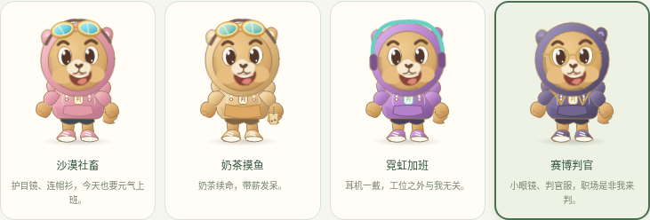
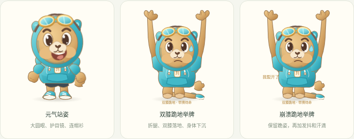

# 职场小判官

Electron + React + TypeScript 的 macOS 桌面宠物。0.3.0 使用原创圆润连帽衫骆驼：大头短身、圆眼高光、奶油色口鼻、护目镜、运动鞋和「判」字工牌。通过矢量渐变呈现立体感，透明、无边框、置顶，可拖动。所有业务界面为中文。





## 骆驼换装版功能

- 待机时循环摸鱼、打哈欠和呼吸动作。
- 联系人分为领导、喜欢的同事、普通同事、讨厌的人、特别讨厌的人；默认分别敬礼、开心蹦跶、招手、滑跪举牌、崩溃滑跪。
- 两类“讨厌”的联系人始终从当前屏幕右边缘滑跪、举牌；跪姿使用独立骨架，双膝落地、两条小腿向后折、鞋朝后、身体下沉、双手举过头顶托住卡片，并标注「双膝跪地」。落地小烟尘会消散，跪姿与卡片持续保留，可选择普通或崩溃跪姿。
- 每个人独立设置动作、进场方式、人物皮肤、卡片皮肤、搞笑特效和最多 60 字的专属台词。同一类别可以有不同剧本。
- 四套原创人物皮肤：沙漠社畜（连帽衫与护目镜）、奶茶摸鱼（奶茶配色、围裙与奶茶）、霓虹加班（撞色连帽衫与耳机）、赛博判官（判官服与眼镜）。四种卡片：摸鱼便签、职场判决书、心动气泡、驼峰过载警报。
- 四种进场：滑入、弹跳、转圈、淡入。搞笑特效：工单暴雨、摸鱼小鱼、爱心撒花、驼峰过载，也可关闭。装饰约三秒后消失，消息继续保留；遵循系统“减少动态效果”偏好。
- 编辑器实时显示预览，可重播，也可在保存前播放真实桌面预览；预览不发真实消息、不调用 AI、不写入历史。
- 卡片展示核心内容、待办事项、截止时间、回复要求。可查看原文、继续跪着、关闭；下一条消息替换当前卡片，之前消息仍在历史中。
- 控制台管理联系人、模拟飞书消息、查询/清空历史、配置昵称与工服颜色。关闭控制台后桌宠继续运行，可从桌宠重新打开。
- 本地配置和最近 200 条消息以 JSON 保存；联系人删除不删除历史，历史保留接收时的姓名、角色和效果快照。新版本兼容旧联系人和消息，读取时补齐默认人物皮肤，无需清空数据。
- 默认使用离线规则摘要，也可启用本机 Ollama AI。没有真实飞书登录、监听或发送功能，不会给真实联系人发消息。

0.3.0 验证范围：类型检查、生产构建、33 项单元测试与 Linux Xvfb 上的真实 Electron 桌面验收；跪姿额外检查双膝与地面的位置、折叠小腿、站姿隐藏、双手托举和身体下沉。实际 macOS 实机效果、DMG 和 Ollama 模型推理仍需要在对应环境验证。

## 项目结构

```text
electron/
  main.ts             主进程、双窗口、IPC、消息处理
  preload.ts          最小权限桌面接口
  store.ts            校验、串行更新、原子写入、损坏文件备份
  ai.ts               Ollama AI 接口及明确降级
src/
  App.tsx             桌宠与控制台视图
  components/
    Character.tsx     原创可换装 SVG 骆驼
    MessageCard.tsx    摘要卡片及操作
    ContactEditor.tsx  联系人个性效果编辑器
    EffectPreview.tsx 实时效果预览
    SceneEffects.tsx  搞笑粒子特效
  lib/
    model.ts          类型与输入校验
    summary.ts        离线规则摘要
    effects.ts        默认剧本、个人覆盖、跪姿约束
  styles.css          布局和动画
tests/
  summary.test.ts      摘要和配置校验
  store.test.ts        本地存储测试
  ai.test.ts           AI 协议、输出校验、降级测试
  effects.test.ts      个人效果、快照、旧数据兼容测试
  desktop.cjs          真实 Electron 双窗口自动验收
```

## 在 macOS 启动

安装 Node.js 22.12 或更新的 LTS 版本（本次使用 Node 24）。在项目根目录执行：

```bash
npm ci
npm run dev
```

会打开桌宠与控制台两个窗口。测试面板默认选中「甩锅达人」，输入模拟消息并点击「发送并触发动画」。拖动人物或顶部「拖动小判官」区域移动桌宠；卡片按钮不属于拖动区。

若 Electron 下载因连接 GitHub 超时，可仅为这次安装指定下载镜像，保留默认校验：

```bash
ELECTRON_MIRROR="https://npmmirror.com/mirrors/electron/" npm ci
```

## 从旧版更新及配置效果

关闭旧程序，从 GitHub 的 `desktop-pet-mvp` 分支重新下载 ZIP，解压到新文件夹，在其中执行 `npm ci` 和 `npm run dev`。已装好的 Node.js 可以继续使用；原有数据位于系统应用数据目录，不在源码文件夹内，会自动读取。请保持应用名称与数据目录设置一致。

1. 在「联系人」点击某人的姓名，打开专属效果编辑器。
2. 选择动作、进场、两种皮肤和搞笑特效，输入专属台词；「重播预览」只在编辑器播放，「播放桌面预览」会在透明桌宠上播放草稿。
3. 点击「保存个性效果」后，后续模拟消息使用该配置。恢复类别默认只修改草稿，保存后生效。
4. 「人物设置」选择待机默认皮肤并保存；联系人专属人物皮肤优先，关闭卡片后恢复全局默认皮肤。
5. 「人物设置」中的姿态对比直接展示站立、双膝跪地、崩溃跪地三种造型，方便确认跪姿；控制台左下角版本应为「圆润连帽驼 / 0.3.0」。

原名单不会自动插入新联系人。可以将已有联系人改为「特别讨厌的人」，也可新增联系人。选择跪姿时进场固定为边缘滑入；两类“讨厌”的联系人可定制皮肤、跪姿、特效和台词。

修改渲染界面时 Vite 自动刷新。修改 `electron/` 或主进程共享逻辑后，请停止并重新运行 `npm run dev`。直接在浏览器访问 Vite 地址不能使用桌面接口。

运行生产构建：

```bash
npm run build
npm start
```

## 可选：真正的本地 AI 摘要

默认离线规则不需要模型或账号，也不声称是 AI。若要用大模型理解消息，请从 [Ollama 官方网站](https://ollama.com/download/mac) 安装 macOS 应用并启动，然后执行：

```bash
ollama pull qwen2.5:3b
```

在「人物设置 → 本地 AI 摘要」勾选启用，模型名保持 `qwen2.5:3b`，保存后发送模拟消息。模型须与本机已安装名称一致；也可用其他支持 Ollama JSON 输出的模型。模型下载需要网络和数 GB 磁盘空间。若只安装了 CLI，可在单独终端运行 `ollama serve`。

应用仅访问 `http://127.0.0.1:11434/api/chat`，不会把消息发到云端；固定本机地址，不接受任意远程服务地址。请求最长 30 秒，非成功响应、连接失败、超时或不符合字段要求的响应均降级为本地规则摘要，卡片明确显示原因。模拟发送期间按钮显示「正在送达…」。

规则摘要仅提取关键词与时间表达，不能可靠理解复杂否定、语义或优先级；AI 也可能误判。截止时间保留原文相对日期，不虚构具体日期。始终保留原消息供核对。实际模型推理未在本次 Linux 云环境执行；AI 接口通过协议模拟及异常测试。

## 测试

```bash
npm run typecheck
npm test
npm run test:desktop
```

桌面测试启动真实 Electron，使用独立临时数据目录并清理，覆盖五类动作、待机、四套皮肤、个性覆盖、未保存配置预览、历史快照、减少动态效果、滑跪与卡片操作、重启恢复、清空历史及控制台关闭后桌宠继续运行。跪姿使用几何检查验证膝盖贴地、折叠小腿和头部下沉，并验证站姿被隐藏。截图保存在 `test-results/pet.png`、`panel.png`、`custom-effect.png`、`skins.png` 与 `poses.png`。

在 macOS 的正常图形桌面直接执行。Linux 无图形云环境需要 Xvfb，安装后执行：

```bash
xvfb-run -a npm run test:desktop
```

Playwright Electron 自动化启动器会为测试进程加入 `--no-sandbox`，因此桌面测试仅在隔离环境运行。应用窗口仍声明 `sandbox: true`、上下文隔离、禁用 Node 集成；生产启动不使用 `--no-sandbox`。

本次云机器为无图形桌面的 Linux，已用 Xvfb + Playwright 验证真实 Electron 双窗口。普通 `npm run dev` 的 Electron 启动因云机器缺少可用 Chromium 沙箱而退出；Vite 可正常运行。这是当前 Linux 容器的权限限制，未修改生产脚本关闭沙箱。macOS 实机与 DMG 打包尚待验收。

## 打包 macOS 应用

请在 macOS 上执行（生成 DMG、签名与公证需要 macOS 工具链）：

```bash
npm ci
npm run pack:mac
```

输出目录为 `release/`，包含 Apple Silicon（arm64）和 Intel（x64）的 DMG 与 ZIP，应用名称为「职场小判官」。只打包当前所需架构：

```bash
npm run build
npx electron-builder --mac --arm64
# 或 Intel：npx electron-builder --mac --x64
```

没有开发者证书时生成的是本地测试包。分发给其他用户前，应通过 electron-builder 配置 Apple Developer 证书签名和公证，并配置自有图标；当前包使用 Electron 默认应用图标。凭据通过构建环境安全注入，不写入仓库。构建文档：[electron-builder macOS](https://www.electron.build/mac.html)。本次未在 macOS 构建 DMG，也未验证 macOS 多桌面、全屏、Retina 与签名行为。

## 本地数据

数据文件为 Electron `app.getPath('userData')` 下的 `judge-state.json`，macOS 通常位于：

```text
~/Library/Application Support/职场小判官/judge-state.json
```

开发环境目录可能使用 npm 应用名 `workplace-little-judge`。需要隔离实例或测试时，可以设置 `JUDGE_DATA_DIR` 指向专用目录。数据是本机明文 JSON，不是加密保险库；勿输入敏感真实工作消息。损坏配置会改名为 `.invalid-时间戳` 备份后恢复默认设置。正常写入使用临时文件和原子重命名。

## 已知边界

- 不接入真实飞书，不模拟账号授权。
- 原创 SVG 分组配合 CSS 动画；边缘滑入在置于屏幕右边缘的透明窗口内呈现，特效也局限于桌宠窗口内。
- 窗口透明区域仍可能接收鼠标事件；可拖动窗口避开常用区域。本版未加入鼠标穿透与开机自启动。
- 不恢复上次会话的打开卡片；历史与人物配置会恢复。
- AI 为可选本地模型，需要用户安装 Ollama 和模型；没有账号或付费 API 要求。
