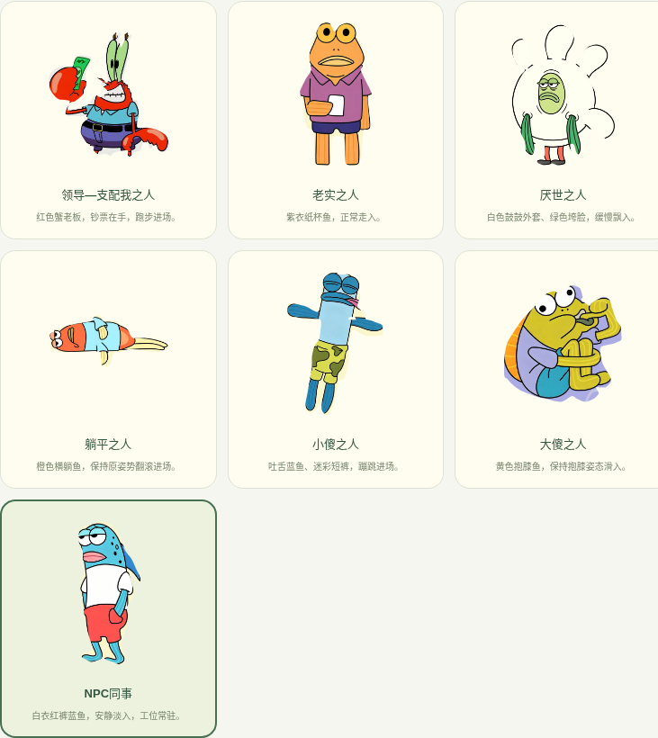
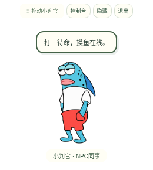
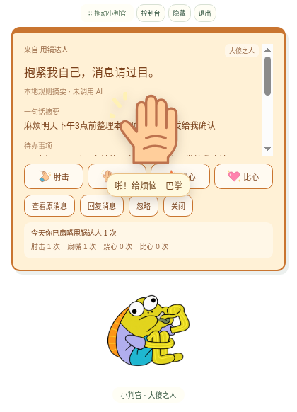

# 职场小判官 · 0.6.0

Electron + React + TypeScript 的 macOS 桌面消息助手。七个人物来自用户上传的「AI-coding人物形象参考.docx」，图片随应用本地保存。人物保持原图的表情、服饰和姿势，统一轻微待机晃动，通过进场方式区分联系人。开发版 0.6.0 提供小尺寸桌宠、肘击/扇嘴/烧心/比心与音效、每日互动统计和七类一键演示。第一阶段只使用模拟飞书消息，真实飞书接入留到 V1.1。









项目目录：

```text
AI-Coding/
├── electron/
│   ├── main.ts             桌面窗口、菜单、消息与文件导入
│   ├── messages.ts         独立消息接收、分析与历史管线
│   ├── interactions.ts     每日联系人互动计数与清空
│   ├── preload.ts          安全的前后端通信接口
│   ├── store.ts            本地校验与原子写入
│   ├── assets.ts           图片、GIF、序列帧导入
│   ├── ai.ts               可替换的 AI 服务与规则降级
│   └── credentials.ts      API Key 系统加密存储
├── src/
│   ├── App.tsx             透明桌宠与中文控制台
│   ├── components/         人物播放器、联系人编辑、消息卡片
│   ├── lib/model.ts        本地配置、消息和接口类型
│   ├── lib/effects.ts      默认进场与个人配置优先级
│   ├── lib/reference-art.ts 精细人物素材与 Lottie 动画
│   ├── lib/leader-outline.ts 蟹老板的精细轮廓
│   ├── lib/summary.ts      明确标记的离线规则解析
│   ├── lib/sounds.ts       原创离线合成音效
│   ├── lib/pet-layout.ts   窗口收缩/展开与屏幕边界
│   ├── interactions.css   趣味互动特效与计数界面
│   └── ocean.css           蓝色海洋控制台主题
├── public/characters/      六张精细透明 PNG
├── public/references/      七张本地人物参考原图
├── tests/                  单元测试与真实 Electron 交互测试
├── docs/Mac使用教程.md
├── 启动职场小判官.command   Mac 双击启动入口
├── package.json
└── package-lock.json
```

## 当前功能

| 联系人类型 | 人物形象 | 默认进场 |
| --- | --- | --- |
| 领导—支配我之人 | 红色蟹老板、蓝衬衫、紫裤、持钞票 | 跑入 |
| 老实之人 | 橙脸、紫衣、纸杯鱼 | 走入 |
| 厌世之人 | 白色鼓鼓外套、绿色垮脸 | 缓慢飘入 |
| 躺平之人 | 橙色横躺鱼、蓝上衣 | 翻滚 |
| 小傻之人 | 吐舌蓝鱼、迷彩短裤 | 蹦入 |
| 大傻之人 | 黄色抱膝鱼、紫衣蓝裤 | 从右侧滑入，保持抱膝 |
| NPC同事 | 白衣红裤蓝鱼 | 淡入 |

- 透明、无边框桌宠；拖动人物或顶部拖动区移动窗口。可切换置顶、隐藏、显示、退出。隐藏后可从控制台或应用菜单恢复；新消息会重新显示桌宠。
- 七类人物使用 Lottie 播放本地素材，统一轻微晃动。个人联系人可设置人物、进场、人物皮肤、卡片皮肤、动画时长、特效与台词，个人配置优先于类型默认。
- 人物皮肤实际改变配色，卡片皮肤在桌面、预览和历史中保持一致。动画时长控制进场时长和待机/序列帧周期；GIF 使用文件自带播放速度。
- 可上传 PNG、JPG、WebP、GIF；一次选择多张静态图会按文件名数字排序为序列帧。上传后显示素材库预览，并可用于待机人物或任意联系人。素材复制到本机，删除原文件后仍可播放。
- 静态图片不会自动生成动作；GIF/序列帧保留素材自身的动作。单图限 5 MB、GIF 限 15 MB，一组最多 60 帧、50 MB，素材库最多 100 组。
- 测试面板可选择联系人、输入消息、发送测试消息并触发完整流程；效果预览不写入历史，也不调用 AI。
- 支持一键播放七类人物，按默认进场自动轮播，可中途停止；不修改联系人，不写历史，不调用 AI。
- 卡片展示一句话摘要、待办、截止时间、紧急程度、回复要求，可查看原消息。
- 桌宠默认缩小为原来的 60%，可在「人物设置」调整到 45%–100%；待机窗口随人物缩小，来消息时展开，忽略/关闭后收缩，保留拖动位置。
- 卡片提供「肘击、扇嘴、烧心、比心」四种互动，分别显示手肘、巴掌、火焰、爱心，并播放原创合成的撞击声、巴掌声、火焰声、清脆提示音。音效离线生成，可在人物设置中静音或调整音量。减少动态效果时仍显示图标。
- 每次点击按联系人 ID 和 Mac 本地日期计数，卡片显示「今天你已肘击甩锅达人 3 次」等提示；同一联系人不同消息合并，四种互动分别计数。控制台「互动统计」显示今日汇总，重启保留，跨日单独计算，保留最近 90 天；预览和七类演示不计数。统计可单独清空，清空消息历史不会清空统计。
- 「忽略」收起消息并恢复待机；「回复消息」打开输入框，发送的模拟回复保存在本地并标记「未发送到飞书」；刚忽略的消息可以重新查看。所有趣味互动仅在本机发生，不会通知真实联系人。
- 清空历史会同步清除桌面与最近判读中的消息内容，未完成解析不会重新写回旧消息。
- 最近 200 条消息与配置保存在本机。历史里的「恢复到桌面」不重复写入、不重复分析。下一条消息会替换当前桌面卡片。
- 兼容旧版五类联系人与骆驼/鱼角色快照，已有配置不自动覆盖。需要新人物时，在联系人编辑中选择七类类型或指定人物。

默认运行不需要 API Key：使用本地规则解析，卡片明确显示「本地规则摘要 · 未调用 AI」。可启用本机 Ollama 或 OpenAI 兼容服务；没有密钥、网络失败或输出无效时，会明确提示并降级为规则解析。

0.6.0 更新：缩小桌宠与待机窗口，新增四种趣味互动、独立音效、每日联系人计数和统计面板。旧配置自动补齐尺寸、声音和统计默认值，保留已有联系人、消息与素材。

控制台使用蓝色海洋渐变、波浪、气泡和浅色半透明面板；装饰不拦截鼠标，开启减少动态效果时停止装饰动画。六个鱼角色使用图像工具处理的透明 PNG，保留人物姿势和主要衣着表情，细节可能有轻微变化；蟹老板保留原图，改用沿黑色描边分析的精细 SVG 轮廓。人物在深色和浅色背景上均进行了检查，不再使用旧版粗略的百分比轮廓。

## 在 Mac 上运行

详细的零基础步骤见 [Mac 使用教程](docs/Mac使用教程.md)。建议使用 Node.js 24 LTS。

解压最新源码 ZIP，打开终端，在项目目录执行：

```bash
npm ci
npm run build
npm start
```

如果 Electron 下载超时（`ETIMEDOUT`，常见于 GitHub 下载）：

```bash
ELECTRON_MIRROR="https://npmmirror.com/mirrors/electron/" npm ci
npm run build
npm start
```

之后启动已构建的同一版本，只需在项目目录执行 `npm start`。也可双击 `启动职场小判官.command`，它会检查 Node/npm、安装必要依赖、构建并启动应用。终端退出或按 Control+C 会停止源码运行的应用。

开发模式：

```bash
npm run dev
```

这会同时启动 Vite 和 Electron。桌面应用在 Electron 窗口中使用；浏览器页面没有桌面通信接口。

## 可选 AI

Ollama：在 Mac 安装并启动 Ollama，运行 `ollama pull qwen2.5:3b`。在「人物设置 → 消息分析服务」启用 AI、选择本机 Ollama、填写模型名称并保存。只向本机 `127.0.0.1:11434` 发送测试消息。

测试面板会在发送前明确显示当前解析模式与数据范围，可直接关闭 AI。在线 AI 仅传输当前消息正文、模型参数和摘要提示，联系人名单、历史、回复与人物素材不上传。人物演示始终离线。

在线服务：在同一页面选择「OpenAI 兼容服务」，填写服务基础地址（如 `https://api.openai.com/v1`）和模型。API Key 仅在你自己的 Mac 界面中输入，点击「保存 API Key」，再保存摘要模式。启用后消息会发送到指定服务。系统加密存储不可用时会拒绝保存密钥。

`electron/ai.ts` 提供 `AiService.analyze()` 与 `createAiService()`，可添加其他适配器。输出用统一结构校验。在线地址要求 HTTPS，本机地址可使用 HTTP；不跟随带密钥的重定向。真实服务失败不会丢失消息。

规则和 AI 结果都需要核对原文，相对日期保留原文。当前测试使用模拟服务响应，未宣称调用了真实在线模型。

## 本地数据

使用 Electron `app.getPath('userData')`：源码运行通常是 `~/Library/Application Support/workplace-little-judge/`，打包后的目录名可能是「职场小判官」。其中：

```text
judge-state.json  联系人、人物/尺寸/音效、AI非秘密设置、历史、每日互动统计、素材索引
assets/          上传素材的本地副本
ai-key.enc       经 Electron safeStorage 加密的 API Key
```

配置经过类型校验、串行原子写入；损坏配置会保留 `.invalid-时间戳` 备份再恢复默认。密钥不写进 JSON、历史、日志或源码。源码和打包应用的目录名若不同，可退出两个应用后复制上述文件及 assets 目录迁移数据。

## 验证

```bash
npm test
npm run build
npm run test:desktop
```

当前 Linux 云环境已通过 68 项单元测试、TypeScript 检查、生产构建，以及真实 Electron 交互测试。新增验证：原生待机窗口收缩/消息展开、尺寸与音量保存、四种互动图标与动画、实际 Web Audio 节点启动和静音、联系人跨消息累计/跨窗口同步/重启保存/独立清空、预览不计数。单元测试还验证跨本地午夜/时区、同名与改名联系人、并发点击及 90 天保留范围。已有七类人物、演示、消息回复、AI 降级、素材导入与显示、隐藏置顶和清空历史也通过验收。测试使用独立临时数据目录。

Linux 云端桌面测试需要 Xvfb；测试脚本仅在 Linux 测试进程中使用 `--no-sandbox`。应用默认保留 `sandbox: true`、上下文隔离和禁用 Node 页面访问，Mac 启动不使用该测试参数。截图输出在 `test-results/`。

本次 `npm audit --omit=dev --audit-level=high` 检查报告生产依赖 0 项漏洞；未新增外部动画或音频依赖。

仍需在你的 Mac 手动验收：扬声器实际听感/音量/静音、缩小人物后的拖动与卡片展开位置、跨 Spaces/全屏/多显示器置顶、Retina 清晰度、系统文件选择器、Keychain 密钥存储、真实 AI 响应、DMG 安装和系统权限提示。云端音频测试验证生成的声音数据和播放节点，不能代替实际听音。云端没有运行 macOS，也没有生成已签名的 Mac 安装包。

## 打包 Mac 应用

在 Mac 的项目目录执行：

```bash
npm run pack:mac
```

生成文件在 `release/`，包含 Apple Silicon（arm64）和 Intel（x64）的 DMG/ZIP。选择与你的芯片对应的 DMG，双击打开，将「职场小判官.app」拖到「应用程序」。安装后可直接从应用程序或启动台打开，不需要终端。

本项目没有配置 Apple Developer 签名与公证。首次打开若有“无法验证开发者”提示，确认来源后到系统设置 → 隐私与安全性 → 仍要打开。正式分发前需要配置签名和公证。请使用本机实际打包结果验收，不把源码 ZIP 当作已打包安装包。

## 飞书真实接入边界

见 [飞书消息接入方案](docs/飞书消息接入方案.md)。当前只接受模拟来源；企业机器人事件与管理员权限在 V1.1 验证。没有默认读取个人全部私聊的能力，也没有跨应用通知读取或绕过企业权限的实现。
